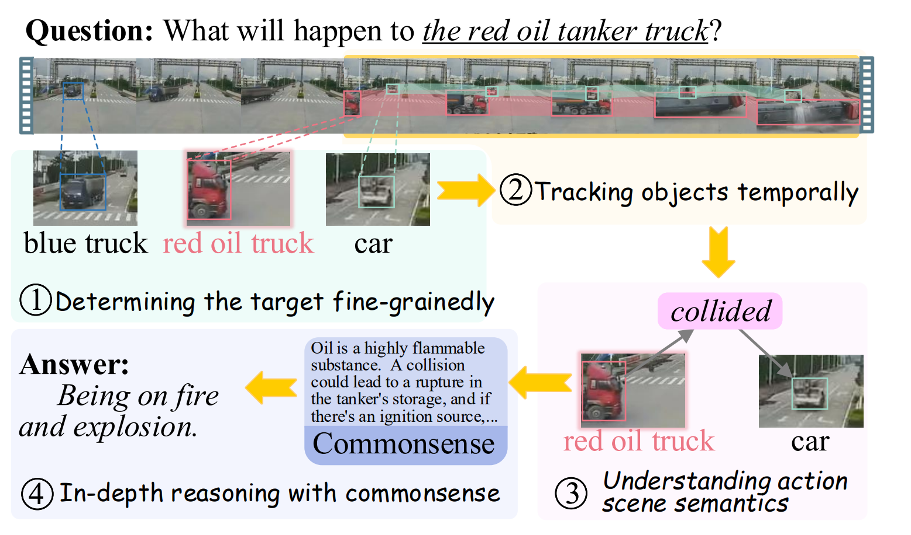
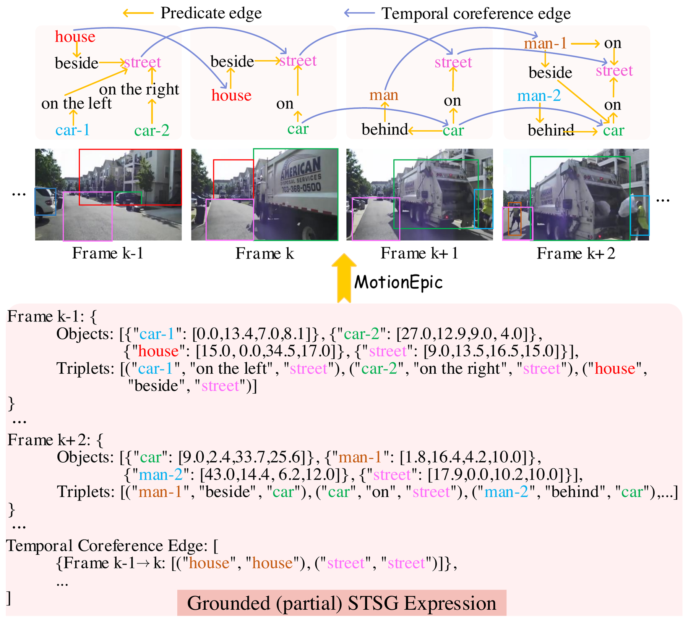
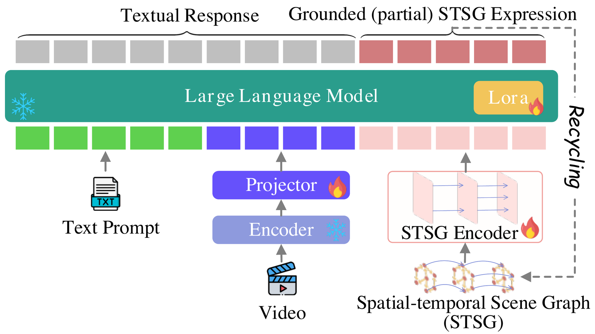
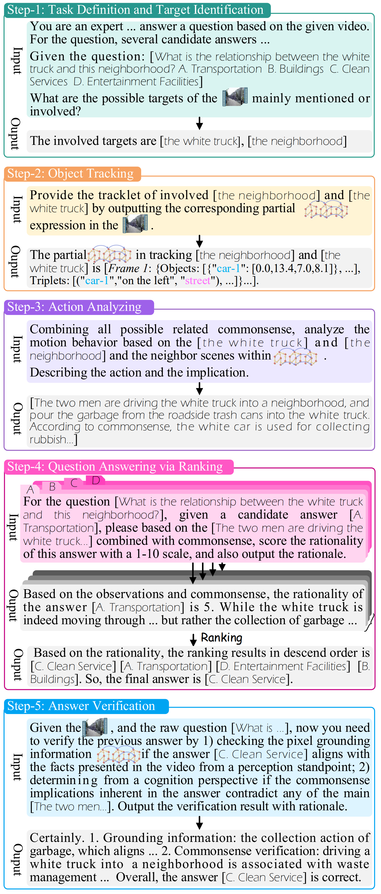
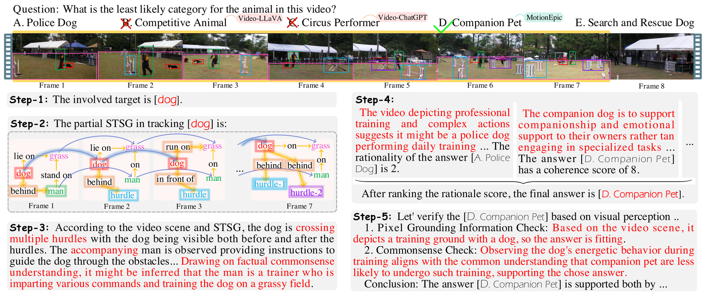

<h1 align="center">🤔🎞️ Video-of-Thought: Step-by-Step Video Reasoning<br>from Perception to Cognition</h1>

<p align="center">
  <b>ICML 2024 (Oral)</b>
</p>

<p align="center">
  <a href="http://haofei.vip/">Hao Fei</a>,
  <a href="https://chocowu.github.io/">Shengqiong Wu</a>,
  Wei Ji,
  <a href="https://personal.ntu.edu.sg/hanwangzhang/">Hanwang Zhang</a>,
  <a href="https://zhangmeishan.github.io/">Meishan Zhang</a>,
  <a href="https://www.comp.nus.edu.sg/~leeml/">Mong Li Lee</a>,
  <a href="https://www.comp.nus.edu.sg/~whsu/">Wynne Hsu</a>
</p>

<p align="center">
  <a href="https://haofei.vip/VoT/"></a>
  <a href="https://arxiv.org/abs/2501.03230"></a>
  <a href="https://proceedings.mlr.press/v235/fei24a.html"></a>
  <a href="https://youtu.be/2fKCWjetV-Y"></a>
  
  
</p>

**Video-of-Thought (VoT)** brings chain-of-thought reasoning to video. It
decomposes a complex video question into five sub-problems that move from
**low-level pixel perception** (which objects matter, where they are, how they
move) to **high-level cognition** (what the actions imply, which answer is most
plausible, and whether that answer survives a perception- and commonsense-based
check). The perception side is powered by **MotionEpic**, a video MLLM that
reads and generates **spatial-temporal scene graphs (STSGs)** for fine-grained,
pixel-level grounding.

This repository is a complete, tested re-implementation of the paper:

* 🧠 **The VoT reasoning engine**: all five steps with the paper's prompts, multiple-choice and
  open-ended QA, ranking, and verification with Step-4 re-execution. It works with any video LLM.
* 🔌 **An API version that needs no training**: run VoT on GPT-4o/GPT-5, Claude, or any
  OpenAI-compatible server (vLLM/SGLang with Qwen2.5-VL, InternVL, ...), optionally grounded on
  STSGs from a detector + tracker or a VLM parser.
* 🎞️ **MotionEpic**: the CLIP ViT-L/14 + Q-Former + recurrent graph transformer + Vicuna (LoRA)
  architecture, the five video–STSG grounding objectives, and the three-stage training recipe.
* 📊 **Benchmarks**: converters and paper-style reports for NExT-QA, STAR, VLEP, IntentQA,
  Social-IQ, Causal-VidQA, MSR-VTT-QA and ActivityNet-QA, plus a resumable evaluation runner.

<p align="center"></p>

---

## 📰 News

* **2026-11** — Codebase rewritten from scratch (v1.0): faithful VoT engine, API version, MotionEpic training stack,
  benchmark suite and tests. The previous code remains available in the git history.
* **2024-07** — VoT presented as an oral paper at ICML 2024.

## 📑 Contents

[Method](#-method) · [Installation](#-installation) · [Quick start](#-quick-start) · [API version](#-the-api-version) ·
[MotionEpic](#%EF%B8%8F-motionepic-training) · [Evaluation](#-evaluation) · [Configuration](#%EF%B8%8F-configuration) ·
[Repository layout](#-repository-layout) · [Citation](#-citation)

---

## 🔍 Method

### Spatial-temporal scene graphs as the grounding interface

A video is sampled into frames; each frame carries a scene graph whose nodes are
objects `(label, feature, bbox)` and whose edges are `subject–predicate–object`
triplets. **Temporal coreference edges** link the same object across adjacent
frames, so a tracklet is simply a connected path through the STSG. MotionEpic
reads STSGs through a graph encoder and *writes* them as text, which makes the
grounding explicit, checkable and reusable by later reasoning steps.

<p align="center"></p>

```text
Frame 1: {
    Objects: [{"car-1": [0.0, 13.4, 7.0, 8.1]}, {"street": [9.0, 13.5, 16.5, 15.0]}],
    Triplets: [("car-1", "on the left", "street")]
}
...
Temporal Coreference Edge: [
    {Frame 1 -> 2: [("car-1", "car-1"), ("street", "street")]}
]
```

`vot.stsg` provides the data model, a serializer/parser for this grammar (tolerant to the
formatting slips of real model outputs), tracklet extraction, k-hop neighbour scenes and
target-to-node matching.

### MotionEpic

<p align="center"></p>

| Component | Paper setting | Code |
|---|---|---|
| LLM | Vicuna-7B v1.5, frozen + LoRA | `vot/models/motionepic/modeling.py` |
| Video encoder | CLIP ViT-L/14, frozen, 8 fps | `vot/models/motionepic/vision.py` |
| Projector | Q-Former | `vot/models/motionepic/projector.py` |
| STSG encoder | Graph Transformer with recurrent propagation over frames (6 layers, 768-d), CLIP RoI features as node init | `vot/models/motionepic/stsg_encoder.py`, `featurizer.py` |
| Grounding-aware tuning | L1 video–STSG matching, L2 video→STSG, L3 action→tracklets, L4 object→action + tracklets, L5 bbox→label + tracklet | `vot/data/grounding_tasks.py` |

### The five reasoning steps

<table>
<tr>
<td width="44%"></td>
<td>

| | Step | Produces |
|---|---|---|
| ① | **Task definition & target identification** — which objects does the question involve? | `[Target]` |
| ② | **Object tracking** — output the partial STSG (tracklets) of the targets | `[Target Tracklet]` |
| ③ | **Action analysing** — interpret the tracklets and their neighbour scenes with commonsense | `[Observation & Implication]` |
| ④ | **QA via ranking** — score every candidate 1–10 with a rationale, then rank (open-ended questions first generate candidates) | `[Answer]` |
| ⑤ | **Answer verification** — check the answer against the pixel grounding (perception) and the observations (cognition); on failure, record why and re-run ④ | verified answer |

Every intermediate output is recycled as the input of the next step, and the full trace
(prompts, responses, parsed values, token usage) is returned with the answer.

</td>
</tr>
</table>

---

## 📦 Installation

```bash
git clone https://github.com/scofield7419/Video-of-Thought.git
cd Video-of-Thought
conda create -n vot python=3.10 -y && conda activate vot
pip install -e ".[api,video]"          # reasoning engine + API backends + video decoders
# pip install -e ".[grounding]"        # + Grounding DINO STSG provider
# pip install -e ".[train]"            # + MotionEpic training / local inference (PyTorch, transformers, peft, deepspeed)
# pip install -e ".[all]"
```

The core package depends only on `numpy`, `Pillow`, `PyYAML` and `tqdm`; heavier dependencies are
imported lazily by the components that need them.

## 🚀 Quick start

**1. Offline walk-through (no model, no key).** A rule-based stand-in answers each step from an
illustrative STSG, so you can inspect the exact prompts and the verification loop:

```bash
python examples/offline_demo.py --trace
python examples/offline_demo.py --reject-first   # the first verification fails -> Step 4 is re-executed
```

**2. One question from the command line.**

```bash
export OPENAI_API_KEY=...            # or ANTHROPIC_API_KEY=...
vot run --video demo.mp4 \
        --question "What is the relationship between the white truck and this neighborhood?" \
        --options "Transportation" "Buildings" "Clean Services" "Entertainment Facilities" \
        --backend openai:gpt-4o --out trace.json -v
```

**3. Python API.**

```python
from vot import VideoOfThought, VoTConfig, build_backend

model = build_backend("anthropic:claude-opus-5-5", cache=".cache/vot.sqlite")
vot = VideoOfThought(model, VoTConfig(fps=1.0, max_frames=16))

res = vot("demo.mp4",
          "What is the relationship between the white truck and this neighborhood?",
          ["Transportation", "Buildings", "Clean Services", "Entertainment Facilities"])

print(res.pretty())          # answer, per-option scores, targets, tracklet size, verification
res.partial_stsg             # the grounded tracklets (an STSG object)
res.trace                    # every prompt / response / parsed value
```

Open-ended questions: omit the options; VoT generates and ranks candidates (Step 4-Pre).

## 🔌 The API version

VoT's reasoning chain is independent of how the model is trained. The API version keeps all five
steps and realises the two non-text inputs for off-the-shelf models: the video becomes captioned
frames (`Frame k (t=…s)`), and STSGs become their text expression plus a compact grammar
specification. Because general-purpose models localise objects poorly, Step 2 can be anchored to an
explicit STSG:

| `step2_mode` | Grounding source | Behaviour |
|---|---|---|
| `generate` | none (STSG-free) | the model writes the targets' partial STSG from the frames, as MotionEpic does |
| `select` | full STSG from a provider | the model picks the relevant tracklets; boxes are snapped to the reference |
| `match` | full STSG from a provider | targets are matched to nodes programmatically, without an LLM call |

```bash
# Grounding DINO + IoU tracking builds the STSG, the API model reasons over it
vot run --video demo.mp4 --question "..." --options ... \
        --backend openai:gpt-4o --stsg-provider detector --config configs/vot/api_grounded.yaml

# open-source VLM behind an OpenAI-compatible server
vllm serve Qwen/Qwen2.5-VL-72B-Instruct --limit-mm-per-prompt '{"image": 32}'
vot run ... --backend openai:Qwen/Qwen2.5-VL-72B-Instruct --base-url http://localhost:8000/v1

# inspect a parsed STSG
vot stsg --video demo.mp4 --provider vlm --backend openai:gpt-4o --out demo_stsg.json --viz viz/
```

Backends, providers, cost per instance and caching are described in [docs/api_version.md](docs/api_version.md).
Any other model can be plugged in by implementing one method ([examples/custom_backend.py](examples/custom_backend.py)).

## 🎞️ MotionEpic training

The full training stack is included for reproducibility. As in the paper, the video encoder and the
LLM stay frozen; the Q-Former projector, the STSG encoder and LoRA adapters are trained.

| Stage | Data | Objective | Trainable |
|---|---|---|---|
| 1. Video pre-training | WebVid captions | caption generation | projector |
| 2. Grounding-aware tuning | Action Genome (10K manual STSGs) + 350K WebVid videos with parsed STSGs | L1–L5 | projector, STSG encoder, LoRA |
| 3. Video instruction tuning | VideoChat + Video-ChatGPT instructions | instruction following | projector, STSG encoder, LoRA |
| (4. Task fine-tuning) | benchmark training splits | QA | projector, STSG encoder, LoRA |

```bash
python scripts/data/convert_action_genome.py --help        # AG annotations -> STSG JSON
python scripts/data/build_grounding_corpus.py --help       # STSG JSON -> L1-L5 instruction data
bash scripts/train/stage2_grounding.sh                     # see docs/training.md for all stages
vot run --backend motionepic:checkpoints/motionepic-stage3 --config configs/vot/motionepic.yaml ...
```

Recipes, data formats and hyper-parameters: [docs/training.md](docs/training.md).
**Model weights are not released**; the API version is the ready-to-use path.

## 📊 Evaluation

```bash
# 1) convert the official annotations to the unified JSONL format
python scripts/data/prepare_videoqa.py --benchmark nextqa --raw data/nextqa/raw/val.csv --split val \
       --out data/nextqa/val.jsonl
# 2) run a method (resumable; per-instance traces with --save-trace)
vot eval --benchmark nextqa --data data/nextqa/val.jsonl --video-root data/nextqa/videos \
         --backend openai:gpt-4o --config configs/vot/api.yaml --method vot \
         --workers 8 --cache .cache/nextqa.sqlite --out results/nextqa/gpt4o_vot.jsonl
# -> results/nextqa/gpt4o_vot.report.{json,md}: Acc@All / Acc@C / Acc@T / Acc@D, token usage
```

Supported benchmarks and their metrics are listed in [docs/benchmarks.md](docs/benchmarks.md).
`--method cot` and `--method direct` run the paper's baselines with the same backend and frames.

Results reported in the paper (MotionEpic, fine-tuned setting unless noted):

| Benchmark | Metric | MotionEpic + CoT | **MotionEpic + VoT** |
|---|---|:-:|:-:|
| NExT-QA | Acc@All / C / T / D | 72.2 / 73.4 / 69.1 / 80.7 | **76.0 / 75.8 / 74.6 / 83.3** |
| STAR | Int. / Seq. / Pre. / Fea. | 66.8 / 69.6 / 60.6 / 57.4 | **71.5 / 72.6 / 66.6 / 62.7** |
| VLEP | Acc | 68.2 | **73.4** |
| IntentQA | Acc | 66.1 | **70.8** |
| Social-IQ | 2-way / 4-way | 71.7 / 43.0 | **72.8 / 45.0** |
| Causal-VidQA | D / E / P-AR / C-AR | 78.5 / 77.2 / 52.4 / 55.0 | **81.2 / 83.0 / 54.7 / 58.6** |
| Zero-shot | MSR-VTT / ActivityNet / NExT-QA / STAR | 63.1 / 50.0 / 61.9 / 56.5 | **66.2 / 54.6 / 66.5 / 61.7** |

<p align="center"></p>

## ⚙️ Configuration

`VoTConfig` (YAML presets in [`configs/vot/`](configs/vot)) exposes the design choices of each step:

| Field | Default | Meaning |
|---|---|---|
| `fps`, `max_frames` | 1.0, 16 | frame sampling (MotionEpic preset: 8 fps, 32 frames) |
| `context` | `chain` | Steps 1–3 share one dialogue, or every step is an `isolated` slot-filled call |
| `step2_mode` | `auto` | `generate` / `select` / `match` (see the API version) |
| `neighbor_hops` | 1 | neighbour scenes added around the tracklets for Step 3 |
| `ranking` | `model` | `model` (Step 4-B prompt), `auto` (only on ties), `score` (no ranking call) |
| `num_open_candidates` | 4 | candidates generated for open-ended questions |
| `multi_answer` | false | "choose all possible correct option(s)" task definition |
| `verify_perception`, `verify_cognition` | true, true | the two verification perspectives (Table 4 ablations) |
| `max_verify_rounds` | 2 | re-executions of Step 4 after a failed verification |

Override any field on the command line with `--set key=value`, e.g. `--set ranking=auto --set max_frames=8`.

## 🗂 Repository layout

```text
vot/
├── stsg/            STSG data model, expression grammar (format/parse), matching, graph ops
├── video/           frame sampling (decord / PyAV / OpenCV / frame folders), visualisation
├── reasoning/       VoT engine (vot.py), paper prompts, parsers, results/traces, CoT & direct baselines
├── backends/        VideoLLM interface; OpenAI-compatible, Anthropic, MotionEpic, mock; response cache
├── grounding/       STSG providers: static annotations, VLM parser, detector + tracker
├── models/motionepic/  vision tower, Q-Former, recurrent graph transformer, featurizer, MLLM
├── data/            unified VideoQA format, benchmark converters, L1–L5 grounding tasks, SFT datasets
├── train/           MotionEpic training (HF Trainer, DeepSpeed)
├── eval/            metrics and paper-style reports, benchmark runner
└── cli.py           `vot run | eval | stsg`
configs/             VoT presets, training stages, DeepSpeed
scripts/             data preparation and training launchers
examples/            offline demo, API quick start, custom backend
docs/                method-to-code map, API version, training, benchmarks
tests/               unit and end-to-end tests (offline)
```

Run the test suite with `pytest -q` (no GPU, network or API key needed).

## 📖 Documentation

* [docs/method.md](docs/method.md) — paper-to-code map and implementation decisions
* [docs/api_version.md](docs/api_version.md) — backends, STSG providers, cost, zero-shot protocol
* [docs/training.md](docs/training.md) — MotionEpic data preparation and training stages
* [docs/benchmarks.md](docs/benchmarks.md) — datasets, conversion and metrics

## 📝 Citation

```bibtex
@inproceedings{fei2024video,
  title     = {Video-of-Thought: Step-by-Step Video Reasoning from Perception to Cognition},
  author    = {Fei, Hao and Wu, Shengqiong and Ji, Wei and Zhang, Hanwang and Zhang, Meishan and Lee, Mong-Li and Hsu, Wynne},
  booktitle = {Proceedings of the 41st International Conference on Machine Learning},
  series    = {Proceedings of Machine Learning Research},
  volume    = {235},
  pages     = {13109--13125},
  year      = {2024}
}
```

## 🙏 Acknowledgements

MotionEpic builds on [Vicuna](https://huggingface.co/lmsys/vicuna-7b-v1.5),
[CLIP](https://huggingface.co/openai/clip-vit-large-patch14), [BLIP-2](https://huggingface.co/Salesforce/blip2-opt-2.7b)
and the [Graph Transformer](https://github.com/graphdeeplearning/graphtransformer); grounding data come from
[Action Genome](https://github.com/JingweiJ/ActionGenome) and [WebVid](https://github.com/m-bain/webvid).
We thank the authors of these projects and of the benchmarks used in the evaluation.

## 📄 License

Released under the [Apache License 2.0](LICENSE). Datasets and third-party models keep their own licenses.

## 📬 Contact

Questions and issues: please open a GitHub issue or contact [Hao Fei](mailto:haofei37@nus.edu.sg).
